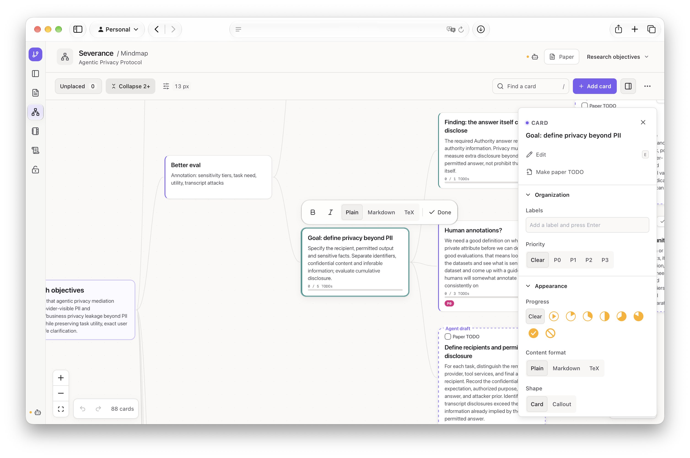
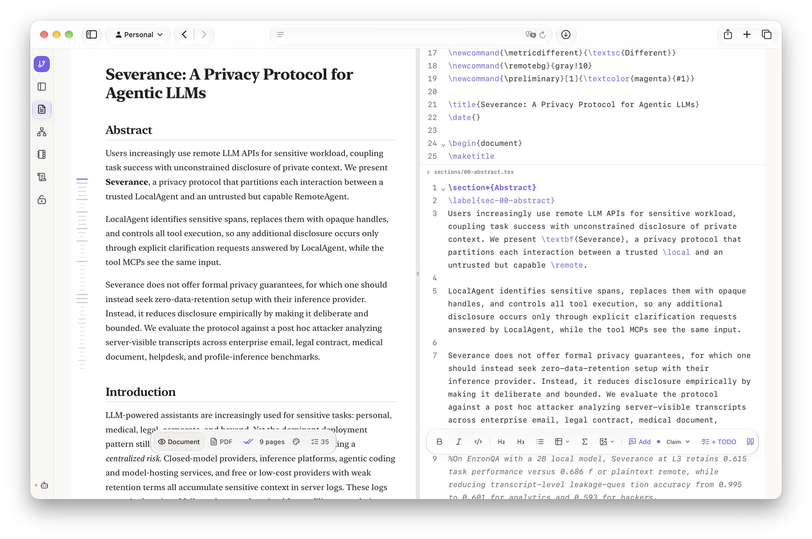

# OpenBar

A research workbench where you and your agent share one view of a project.
Keep the LaTeX manuscript, mindmaps, notes, and instructions in a single
repository so both sides stay aligned on open work and reach each other on the
canvas, using your existing coding or browser agent over MCP or WebMCP with no
LLM provider keys.

| Map the research | Draft the paper |
| --- | --- |
|  |  |

## What it’s for

- **Start drafting before the results exist.** Keep the paper’s shape visible
  from the start: lay out sections, planned comparisons, partial result tables,
  and figure placeholders, with inline `\obtodo`, `\obcomment`, and `\obmarker`
  annotations holding open holes beside the claims they affect until
  measurements fill them in. Includes multi-file LaTeX editing with file
  folding, a companion reader, PDF preview, `.bib` editing and reference
  pasting, citation completion, and Overleaf Git sync.
- **Keep agent-heavy research legible on mindmaps.** Agents produce runs,
  ablations, and notes faster than chat logs or loose folders stay easy to
  follow. Organize hypotheses, findings, dead ends, and synced manuscript TODOs
  across a Primary map (in the tree or waiting in Unplaced) and optional
  secondary views, with short summaries on cards, detail tucked into collapsed
  notes, and rolled-up TODO counts, status markers, priorities, and labels
  showing where each thread stands.
- **Present results in a form others can scan.** Organize findings into
  structured branches with inline tables, attached figures, and compact SVG
  charts, or build focused secondary maps over selected manuscript TODOs when
  sharing a specific part of the work with advisors or collaborators.
- **Stay aligned and ping each other on the canvas, with no LLM keys.** OpenBar
  embeds no model and makes no calls to LLM providers; connect the coding or
  browser agent you already run over MCP or browser WebMCP. Mention `@agent`
  (or `@stat` to put a request first) on any card; your agent reads it
  alongside the manuscript, maps, `AGENTS.md`, and skills, replies inline with
  unread **Agent draft** cards or revision-checked edits, and respects your
  prior card deletions so shared context carries across sessions.

## Run locally

Use the Node version in [.nvmrc](.nvmrc) and the pnpm version in
[package.json](package.json).

```bash
pnpm install
pnpm dev
```

Open [localhost:3000](http://localhost:3000). Projects live under
`content/projects/<slug>`. Set `OPENBAR_CONTENT` to use another content directory,
and set `OPENBAR_DEV_ORIGINS` (comma-separated) if accessing `pnpm dev` over LAN or Tailscale.

Build from a clean checkout and supply secrets at runtime because Next.js copies root `.env` and `.env.production` files into the standalone package when present.

For production, build and copy static assets into the standalone directory before starting:

```bash
pnpm build
cp -a public .next/standalone/public
cp -a .next/static .next/standalone/.next/static
OPENBAR_LOCAL_ACCESS=1 pnpm start
```

Configure production access via `OPENBAR_LOCAL_ACCESS=1` (loopback),
`OPENBAR_ACCESS_TOKEN` (bearer token for MCP/API), or `CLOUDFLARE_ACCESS_TEAM_DOMAIN` + `CLOUDFLARE_ACCESS_AUD`
(Cloudflare Access). See [deploy/README.md](deploy/README.md) for container hosting details.

TeX Live with `latexmk` enables PDF compilation.
[TexLab](https://github.com/latex-lsp/texlab) adds LaTeX completion. See the
deployment guide for optional conversion tools.

## Connect an agent

OpenBar does not embed a model or ask for LLM provider keys. Bring any
MCP-compatible coding agent or browser agent you already use, and open `/agents`
in the running app for setup instructions (Streamable HTTP MCP, stdio bridge,
REST, or browser WebMCP).

Start a session with `get_project_state` to read the current paper, maps,
instructions, and available skills. Leave `@agent` (or `@stat` for priority
requests) on a mindmap card, then say “check updates” (or “tick”) to inspect
and answer the agent inbox.

The manuscript owns TODO text and completion. Each mindmap owns its layout,
labels, and presentation. Browser preferences stay on the current device.

## Who it’s for

- **Me!** Every researcher thinks and organizes differently, so OpenBar is
  built around how I work rather than aiming to be a universal tool.
- **Hopefully you too, if you make it yours.** If any of this clicks with your
  own projects, grab a fork under the MIT license and reshape it around the way
  you think.

## Documentation

- [Architecture and product model](docs/architecture.md)
- [MCP and WebMCP operations](docs/webmcp.md)
- [Hosting and deployment](deploy/README.md)
- [Release checks](docs/release-acceptance.md)
- [Agent instructions](AGENTS.md)

## Development

```bash
pnpm typecheck
pnpm build
```

[MIT license](LICENSE).
